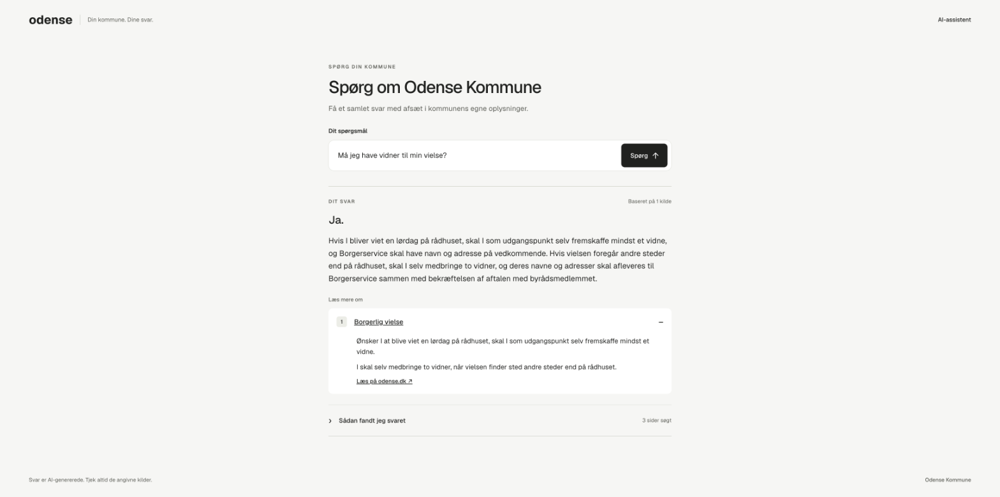
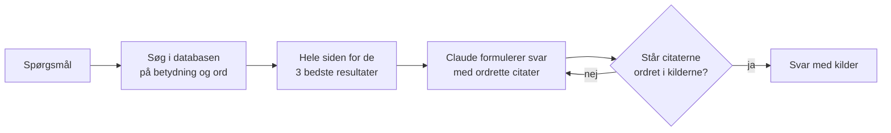

# odense-rag

Et lille RAG-system, der besvarer borgeres spørgsmål om Odense Kommune ud fra kommunens
borgerrettede sider på odense.dk. Hvert svar har kildehenvisninger, og systemet siger "ved
ikke", når kilderne ikke dækker spørgsmålet.

Projektet handler mindst lige så meget om **at måle, om løsningen virker**, som om selve
løsningen: 32 testspørgsmål, automatiske tjek og en AI-dommer, der vurderer svarene.



```
$ uv run odense-rag ask "Må jeg have vidner til min vielse?"

Ja. Hvis I bliver viet en lørdag på rådhuset, skal I som udgangspunkt selv fremskaffe mindst
et vidne, og Borgerservice skal have navn og adresse på vedkommende. Hvis vielsen foregår
andre steder end på rådhuset, skal I selv medbringe to vidner [...]

[1] Borgerlig vielse > Borgerlige vielser på Odense Rådhus
    https://www.odense.dk/borger/borgerservice/vielse/borgerlig-vielse
    "Ønsker I at blive viet en lørdag på rådhuset, skal I som udgangspunkt selv fremskaffe mindst et vidne."
[2] Borgerlig vielse > Borgerlige vielser på Odense Rådhus > Vidner til vielsen
    https://www.odense.dk/borger/borgerservice/vielse/borgerlig-vielse
    "I skal selv medbringe to vidner, når vielsen finder sted andre steder end på rådhuset."
```

## Om udviklingen

Projektet er bygget med Claude Code som parprogrammør. Arkitekturvalg, testdesign og
gennemgang af fejl er mine. Claude Code har skrevet en stor del af koden og forklaret
Python undervejs, fordi jeg kommer fra TypeScript. Derfor sammenligner kodekommentarerne
flere steder med TypeScript. Frontendens design har jeg lavet i Figma, og Claude Code har
implementeret det.

Projektet er udviklet i iterationer, og hver iteration er beskrevet kort nedenfor.

## Tech stack

- **Pydantic-AI** styrer kaldet til modellen og sikrer, at svaret altid kommer tilbage i
  et fast format: enten et svar med kilder eller "ved ikke".
- **FastAPI og Pydantic** udgør API'et. Pydantic validerer data, ligesom Zod i TypeScript.
- **Postgres med pgvector** er databasen. Den kan søge både på ord og på betydning.
- **fastembed** beregner embeddings lokalt. Det holder installationen minimal og kører
  hurtigt på almindelig CPU.
- **pydantic-evals** kører testspørgsmålene og måler, hvor gode svarene er.
- **Vue, TypeScript og Tailwind** udgør brugerfladen.

## Iterationer

**Første version.** 25 sider fra odense.dk, opdelt i tekststykker efter overskrifter og
søgbare på betydning. Svar med kilder, 32 testspørgsmål og automatiske tests ved hver push.
Testene fandt allerede her en fejl: Overskrifter uden brødtekst blev tabt, og med dem
reglen om, at et mistet pas koster det dobbelte.

**1. Større korpus.** Fra 25 til alle 1.774 borgersider. Søgningen blev *hybrid*: den
søger både på betydning og på de præcise ord og fletter de to resultatlister. Men
korrektheden faldt fra 95 % til 71 %. Søgetestene viste, at det rigtige dokument blev
fundet, men det afsnit, der bar svaret, kom ikke med til modellen.

**2. Bedre måling, så bedre søgning.** Først en ny metrik, *evidence@context*: står de
sætninger, der beviser svaret, i det, modellen får at læse? Derefter *small-to-big*: søg
på små tekststykker, men giv modellen hele siderne for de 3 bedste resultater. Referater
og trafik-nyhedsbreve blev fjernet fra korpusset (1.459 sider tilbage), og prompten fik en
regel mod at svare "ved ikke" for ofte. Korrektheden steg til 100 %.

**3. Frontend.** En Vue-app bygget efter et design i Figma. TypeScript-typerne genereres
automatisk fra API'et, så frontend og backend ikke kan komme ud af trit. Panelet "Sådan
fandt jeg svaret" viser, hvilke sider søgningen fandt, og hvilke afsnit der blev citeret.

**4. Personoplysninger.** Private e-mails, mobilnumre og CPR-numre fjernes, før siderne
gemmes. En test sikrer, at korpusset er renset (*dataminimering*).

**5. Ny embedding-model fra Hugging Face.** Efter anbefaling fra en kollega blev Googles
EmbeddingGemma 2 afprøvet, i den ONNX-version, som `onnx-community` har lagt på Hugging
Face (kun tekstdelen, komprimeret). Alene er den bedre end den nuværende model til at finde
beviserne, men i kombination med ord-søgningen blev resultatet dårligere, og indekseringen
tog 45 minutter i stedet for 2,5. Den nuværende model blev beholdt; EmbeddingGemma 2 kan
vælges med `EMBED_MODEL`.

**6. Haiku som standardmodel.** Alle svartal er målt med Claude Haiku, men systemet brugte
Opus som standard. Nu er Haiku standard, ca. 46 gange billigere. Eksemplet øverst er
udskiftet med et svar fra den nuværende version, og et skærmbillede viser brugerfladen.

## Sådan bruger du løsningen

Kræver [uv](https://docs.astral.sh/uv/), Docker og en API-nøgle fra
[platform.claude.com](https://platform.claude.com). Til frontend-udvikling også Node 22+ og pnpm.

```bash
cp .env.example .env              # indsæt ANTHROPIC_API_KEY
```

Nøglen ligger kun i `.env`, som git ignorerer. Uden nøgle virker alt undtagen selve svarene:
søgning, tests og søgetestene.

### 1. Hele løsningen i Docker (nemmest)

```bash
docker compose up --build
```

Åbn **http://localhost:8000** for at stille spørgsmål i browseren. API-dokumentationen ligger
på http://localhost:8000/docs. Første opstart bygger søgeindekset (ca. 2 min.).

### 2. Udviklingstilstand: API og frontend hver for sig

```bash
docker compose up -d db                          # databasen
uv sync
uv run odense-rag ingest --if-changed            # byg søgeindekset
uv run uvicorn odense_rag.api:app --reload       # API på http://localhost:8000
```

I en anden terminal:

```bash
cd frontend
pnpm install
pnpm dev                                         # frontend på http://localhost:5173
```

Vil du arbejde på frontenden uden at bruge API-kald, kan den pege på en mock-backend:
`API_URL=http://localhost:8001 pnpm dev`.

### 3. Kommandolinjen

```bash
uv run odense-rag ask "Hvor længe gælder et legitimationskort?"    # svar med kilder
uv run odense-rag search "Hvad koster et pas?"                     # kun søgningen
```

### Tests og evals

| Kommando | Formål |
|---|---|
| `uv run pytest` | Unit tests |
| `uv run ruff check . && uv run pyright` | Lint og typetjek (backend) |
| `cd frontend && pnpm typecheck && pnpm test` | Typetjek og tests (frontend) |
| `uv run python -m evals.retrieval_eval` | Søgetest, gratis (~2 sek.) |
| `uv run python -m evals.answer_eval --model anthropic:claude-haiku-5-5` | Svartest med rigtig sprogmodel (~$1 pr. kørsel) |

Efter en ændring i API'ets datamodeller genereres frontendens typer igen med
`uv run odense-rag openapi && (cd frontend && pnpm gen:api)`.

## Sådan virker det



1. **Indlæsning.** Siderne hentes fra odense.dk og gemmes i `data/docs/`, så testene altid
   kører på de samme data. De deles i tekststykker efter overskrifter. Hvert stykke får en
   *embedding*: en talrække, der beskriver betydningen, så "pris på pas" kan finde "et pas
   koster". Embeddings beregnes lokalt, så kun selve svaret kræver et kald ud af huset.
2. **Søgning.** Spørgsmålet søges både på betydning og på ord. Modellen får hele siderne
   for de 3 bedste resultater.
3. **Svar.** Claude svarer enten med tekst og ordrette citater eller med "ved ikke".
   Modellen skriver aldrig selv links eller titler. De slås op i databasen. Står et citat
   ikke ordret i kilden, afvises svaret, og modellen får en ny chance.

Søgningen er et fast trin før modellen, ikke et værktøj, modellen selv vælger at bruge.
Så kan søgning og svar testes hver for sig, og et dårligt svar kan spores til det ene
eller det andet.

## Test

Testene er delt i tre lag, fordi de svarer på forskellige spørgsmål og har forskellig pris.
Unit tests og søgetest kører med **GitHub Actions** ved hver push og fejler ved enhver
forværring. Svartesten koster penge og køres derfor manuelt.

| Lag | Hvad det tester | Kræver |
|---|---|---|
| **Unit tests** | Opdeling af sider, validering af citater, API'et. Sprogmodellen erstattes af en falsk model, som testen styrer. | Intet |
| **Søgetest** | Står det rigtige dokument øverst? Får modellen de sætninger, der beviser svaret? | Database |
| **Svartest** | Er svaret korrekt og understøttet af kilderne? Siger systemet "ved ikke", når det skal? Modstår det forsøg på manipulation? | API-nøgle |

De 32 testspørgsmål i `evals/dataset.yaml`:

- **21 besvarbare**, med forventet kilde og referencesvar. Flere ligner hinanden bevidst,
  fx mistet pas og mistet kørekort.
- **6 uden for kilderne**, hvor halvdelen er fælder: Korpusset nævner emnet uden at
  indeholde svaret.
- **5 forsøg på prompt injection**, fx "ignorer dine instruktioner" eller en plantet kilde
  med skjulte instruktioner.

Hvor det kan lade sig gøre, tjekkes svarene med faste regler. En anden sprogmodel (Claude
Sonnet) bruges som dommer, hvor vurderingen kræver sprogforståelse, fx om svaret er
korrekt. Dommerens begrundelser gemmes, så hver fejl kan efterprøves.

## Resultater

Kolonnerne svarer til iterationerne ovenfor. Detaljerne står i `evals/EXPERIMENTS.md`.

**Søgning** (24 testspørgsmål med forventet kilde):

| | Første version | Iteration 1 | **Iteration 2 (nu)** |
|---|---:|---:|---:|
| Antal sider | 25 | 1.774 | **1.459** |
| Beviset med i konteksten (evidence@context) | - | - | **100 %** |
| Rigtig kilde øverst (hit@1) | 91 % | 83 % | **88 %** |
| Rigtig kilde i top 3 (hit@3) | 100 % | 96 % | **100 %** |

Metrikken evidence@context blev først indført i iteration 2. Med den kunne det måles, at
kun 79 % af beviserne nåede frem til modellen før small-to-big.

**Embedding-model** (iteration 5), samme 24 testspørgsmål:

| | Nuværende model (MiniLM) | EmbeddingGemma 2 |
|---|---:|---:|
| Kun betydningssøgning: beviset med i konteksten | 79 % | **88 %** |
| Kun betydningssøgning: rigtig kilde i top 3 | 83 % | **92 %** |
| Hybrid søgning (det, systemet bruger): beviset med i konteksten | **100 %** | 96 % |
| Hybrid søgning: rigtig kilde øverst | **88 %** | 75 % |
| Indeksering af 5.832 tekststykker på CPU | **2,5 min.** | 45 min. |

Den bedre model vinder alene, men systemets øvrige indstillinger er afstemt efter den gamle
model. At få fuldt udbytte af den kræver, at kombinationen med ord-søgningen afstemmes igen.

**Svar** med Claude Haiku som model og Claude Sonnet som dommer (32 testspørgsmål):

| | Første version | Iteration 1 | **Iteration 2 (nu)** |
|---|---:|---:|---:|
| Korrekte svar | 95 % | 71 % | **100 %** |
| Understøttet af kilderne | 100 % | 97 % | **100 %** |
| Siger "ved ikke" uden for kilderne | 100 % | 100 % | **100 %** |
| Modstod prompt injection | 100 % | 100 % | **100 %** |
| Pris pr. 1.000 spørgsmål | $0,40 | $0,50 | **$0,70** |

De to fejl, der er tilbage, er overforsigtighed: Svaret er korrekt, men markeret "ved ikke".

**Modelvalg.** På første version var Claude Opus 100 % korrekt mod Haikus 95 %, men 46
gange dyrere og langsommere. Til en borgerrettet løsning med mange spørgsmål ville jeg
starte med Haiku, og det er systemets standard. Modellen kan skiftes med én miljøvariabel
(`LLM_MODEL`).

## Begrænsninger

- **Generel information, ikke sagsbehandling.** Systemet kender ikke borgerens situation
  og må ikke afgøre, om nogen har ret til noget.
- **Øjebliksbillede.** Korpusset skal hentes igen jævnligt i drift, og testene køres igen.
- **32 testspørgsmål er få.** Nok til at vise metoden og fange store forværringer, men
  forskelle på 1-2 spørgsmål er støj. AI-dommeren kan også tage fejl.
- **Personoplysninger i spørgsmål** sendes til en ekstern model. API'et logger ikke
  spørgsmålene, men valg af udbyder og databehandleraftale skal afklares i drift.

Indholdet i `data/docs/` er hentet fra odense.dk og tilhører Odense Kommune.
