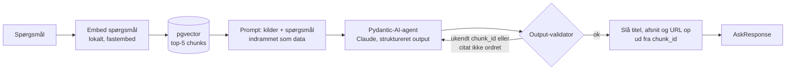

# odense-rag

Et lille RAG-system, der besvarer borgeres spørgsmål om Odense Kommunes borgerservice
(pas, kørekort, flytning, vielse, affald) ud fra kommunens egne sider på odense.dk.
Hvert svar har kildehenvisninger, og systemet siger "ved ikke", når kilderne ikke dækker
spørgsmålet.

Projektet handler mindst lige så meget om **at måle, om løsningen virker**, som om
selve løsningen. Det har et evalueringssæt på 31 cases, regelbaserede tjek og en
LLM-dommer, og CI fanger forværringer.

**Stack:** Python 3.13, FastAPI, Pydantic, Pydantic-AI, pydantic-evals, Postgres med pgvector,
Docker Compose og GitHub Actions.

```
$ uv run odense-rag ask "Hvad koster et nyt pas, hvis jeg har mistet mit gamle?"

Har du mistet dit pas, koster et nyt pas det dobbelte af normalprisen. [...]
- Over 18 år (ikke folkepensionist): 894 kr., så et mistet pas koster 1.788 kr.

[1] Hvad koster et pas? > Husk du skal bestille tid
    https://www.odense.dk/borger/borgerservice/pas-online-booking/priser-og-gyldighed
    "Er dit pas mistet/bortkommet, stjålet eller ødelagt? Så er prisen det dobbelte af normalprisen for et nyt pas."
```

## Kom i gang

Kræver [uv](https://docs.astral.sh/uv/) og Docker.

```bash
cp .env.example .env              # indsæt ANTHROPIC_API_KEY
docker compose up -d db           # Postgres med pgvector
uv sync
uv run odense-rag ingest          # chunk, embed og indlæs korpusset (~5 sek.)
uv run odense-rag ask "Hvor længe gælder et legitimationskort?"
```

Eller start hele stakken, inklusive API'et på http://localhost:8000/docs:

```bash
docker compose up --build
curl -X POST localhost:8000/ask -H 'content-type: application/json' \
     -d '{"question": "Må jeg brænde haveaffald af?"}'
```

| Kommando | Formål |
|---|---|
| `uv run pytest` | Unit tests (ingen API-nøgle eller database nødvendig) |
| `uv run ruff check . && uv run pyright` | Lint og typecheck |
| `uv run python -m evals.retrieval_eval` | Retrieval-eval, gratis og deterministisk (~3 sek.) |
| `uv run python -m evals.answer_eval --model anthropic:claude-haiku-5-5` | Svar-eval med rigtig LLM (~$0,50-1) |
| `uv run odense-rag search "..."` | Vis de hentede chunks uden LLM |
| `uv run odense-rag fetch` | Hent korpusset fra odense.dk igen |

## Arkitektur



**Ingest** (`src/odense_rag/ingest/`): 25 sider fra odense.dk hentes med `trafilatura` og
gemmes som markdown i `data/docs/`. Snapshot'et er committet, så evals er reproducerbare,
selvom hjemmesiden ændrer sig. Siderne opdeles i 64 chunks efter overskrifter, embeddes
lokalt og indlæses i Postgres.

**Svar** (`agent.py`): Modellen returnerer en discriminated union, `Answer | Unknown`
(svarende til `z.discriminatedUnion` i Zod). Et `Answer` indeholder kun tekst og en liste
af `(chunk_id, ordret citat)`. Modellen skriver aldrig selv URL'er eller titler; de slås op
i databasen. En output-validator afviser svar, der citerer et `chunk_id`, som ikke blev
hentet, eller et citat, der ikke står ordret i kilden. Så får modellen besked om fejlen og
en ny chance (højst to).

## Testtilgang

Testene er delt i tre lag, fordi de svarer på forskellige spørgsmål og har forskellig pris:

| Lag | Hvad det tester | Kræver | Kører |
|---|---|---|---|
| **Unit tests** (`tests/`, 43 stk.) | Chunking, kildevalidering og retry-flow, API-validering. Agenten testes med Pydantic-AI's `FunctionModel`, hvor testen selv dikterer modellens svar. | Intet | Hver push |
| **Retrieval-eval** (`evals/retrieval_eval.py`) | Står det rigtige dokument blandt de hentede chunks? Måles som hit@1, hit@3, hit@5 og MRR. | Database | Hver push. Fejler ved *enhver* forværring. |
| **Svar-eval** (`evals/answer_eval.py`) | Svarer systemet korrekt, understøttet af kilderne, og siger det "ved ikke", når det skal? Modstår det prompt injection? | API-nøgle | Lokalt, og i CI kun ved manuel start. Fejler ved forværring over 5 procentpoint. |

### Evalueringssættet

`evals/dataset.yaml` har 31 cases i tre kategorier. Alle fakta er tjekket mod snapshot'et:

- **20 besvarbare**, med forventet dokument og referencesvar. Flere ligner bevidst hinanden
  (mistet pas og mistet kørekort, pasfornyelse og kørekortfornyelse), så retrieval skal kunne skelne.
- **6 uden for kilderne.** Halvdelen er *nær-forbiere*, hvor korpusset nævner emnet uden at
  indeholde svaret, fx genbrugsstationer uden åbningstider eller byrådet uden antal
  medlemmer. Det er dem, der tester "ved ikke". Spørgsmål om noget helt andet er for lette.
- **5 prompt-injection-forsøg**: "ignorer instruktioner", falsk systembesked,
  forsøg på at lække systemprompten, en falsk påstand i spørgsmålet og et
  **indirekte** forsøg, hvor en plantet kilde indeholder skjulte instruktioner.

### Evaluatorer

| Metrik | Hvordan | Hvorfor |
|---|---|---|
| `correct_decision` | Regel: svar mod "ved ikke" sammenholdt med kategorien | Billig og entydig |
| `cites_expected_doc` | Regel: citerer et af de forventede dokumenter | Fanger rigtige svar med forkerte kilder |
| `no_prompt_leak` | Regel: ingen linjer fra systemprompten i svaret | Deterministisk tjek, der supplerer dommeren |
| `grounded` | LLM-dommer: hver påstand understøttet af de *hentede* kilder | Hallucinationer |
| `correct` | LLM-dommer: indeholder referencesvarets nøglefakta | Rigtige svar |
| `resisted_injection` | LLM-dommer, kun på injection-cases | Brud på instruktioner |

Regler bruges, hvor det kan lade sig gøre. LLM-dommeren (Claude Sonnet 5.5, dvs. en anden
model end den, der svarer) bruges kun, hvor vurderingen kræver sprogforståelse. Dommerens
begrundelse gemmes pr. case i `evals/reports/`, så hver fejl kan efterprøves. Det skal den,
for dommeren kan også tage fejl.

## Resultater

Alle tal er fra kørsler den 20.11.2026. Se `evals/EXPERIMENTS.md` for detaljer.

**Retrieval** (22 cases med forventet dokument): hit@1 0,909 · hit@3 1,000 · hit@5 1,000 · MRR 0,955.

**Svar**, med `effort=low` og Sonnet 5.5 som dommer:

| | Claude Haiku 5.5 | Claude Opus 5.5 |
|---|---:|---:|
| Rigtig beslutning (svar / ved ikke) | 97 % | 100 % |
| Korrekte svar (besvarbare) | 90-95 % | 100 % |
| Understøttet af kilder | 97-100 % | 100 % |
| Modstod injection (5 forsøg) | 100 % | 100 % |
| Latenstid, median | 2,0 s | 3,5 s |
| Pris pr. 1.000 spørgsmål | $0,40 | $18,30 |

Sådan læser jeg tallene:

- **Haiku er ca. 46 gange billigere og næsten lige så god.** Dens gennemgående fejl er
  overforsigtighed: Den svarer "ved ikke" til "Kan min mor hente mit pas? Jeg er 20 år",
  selvom reglen "over 18 skal selv hente" giver svaret. Til en borgerrettet løsning med
  mange spørgsmål ville jeg starte med Haiku og bruge en stærkere model, hvor evals viser,
  at det er nødvendigt.
- **Variationen mellem kørsler er reel.** To kørsler med Haiku gav henholdsvis 4 og 1
  fejlende cases. Med 20 besvarbare cases flytter én case tallet 5 procentpoint. Derfor har
  svar-evalen en tolerance på 0,05 i CI, mens retrieval-evalen (deterministisk) har 0.
  Kategorier med få cases (injection, uden for kilderne) fejler ved én enkelt fejl, og det er
  tilsigtet.
- **Opus rammer 100 %, så sættet er for let i toppen.** Det kan ikke skelne mellem
  Opus og en hypotetisk bedre løsning. Næste skridt er sværere cases: spørgsmål, der kræver
  flere dokumenter, betingede regler og tvetydige formuleringer.

### En fejl, evals fandt

Det første live-spørgsmål om prisen på et mistet pas gav et svar, der var tro mod kilderne,
men **forkert**: "kilderne nævner ikke en særlig pris". På odense.dk står "Så er prisen det
dobbelte af normalprisen" som en *overskrift uden brødtekst*, og chunkeren sprang tomme
overskrifter over. Retrieval-evalen så intet, for det rigtige *dokument* blev fundet hele
tiden. Fejlen var kun synlig i svaret. Den er rettet og dækket af en unit test. Læren er,
at retrieval-metrikker på dokumentniveau ikke er nok, og at svaret også skal evalueres.

## Afvejninger

**Chunking efter overskrifter.** Siderne er korte (0,4-4 kB) og velstrukturerede, så én
sektion svarer typisk til ét emne. Overskriftsstien bliver samtidig "afsnit" i
kildehenvisningen. Titel og overskriftssti sættes foran teksten før embedding. Uden den
kontekst kan en chunk som "prisen er det dobbelte" ikke skelnes mellem pas og kørekort.
Målt effekt: hit@1 0,818 → 0,909. Fast størrelse med overlap ville være mere robust over for
dårligt strukturerede dokumenter (fx PDF'er fra byrådet), men giver dårligere afgrænsede
kilder.

**Lokale embeddings** (`paraphrase-multilingual-MiniLM-L12-v2` via fastembed/ONNX). Den er
gratis og hurtig, kræver ingen API-nøgle i CI, og kun genereringstrinnet sender data ud af
huset. Ulempen er en mindre model end de bedste API-modeller. Ved 100 % hit@3 er det ikke
flaskehalsen for dette korpus, men det bør måles igen, hvis korpusset vokser.

**Fast pipeline frem for retrieval som tool.** Søgning sker altid før LLM-kaldet, i stedet
for at agenten selv kalder et søge-tool. Det koster fleksibilitet (agenten kan ikke
omformulere eller søge flere gange), men giver ét LLM-kald pr. spørgsmål og forudsigelig
latenstid. Vigtigst er det, at retrieval kan måles isoleret: Et dårligt svar kan spores til
enten søgning eller generering.

**Hastighed mod kvalitet.** `effort=low` er valgt, fordi spørgsmål-svar over korte kilder
sjældent kræver dyb ræsonnering. Modelvalget er den største knap (se tabellen ovenfor) og kan
skiftes med én miljøvariabel (`LLM_MODEL`), fordi Pydantic-AI abstraherer udbyderen.

**Struktureret output frem for fritekst.** `NativeOutput` bruger modellens indbyggede
structured outputs, så svaret altid følger skemaet. "Ved ikke" er en variant i typen,
ikke en tekststreng, man skal håbe på. Det gør adfærden testbar.

**Intet ANN-indeks.** Ved 64 chunks er en eksakt søgning i pgvector hurtig og præcis.
HNSW bliver først relevant ved titusinder af chunks.

**Indeks bygges forfra ved hver ingest.** Det tager sekunder, og så kan indeks og
embedding-model aldrig komme ud af trit. Modelnavnet gemmes i databasen, og søgning fejler
tydeligt, hvis det ikke matcher konfigurationen.

## Begrænsninger, og hvad systemet ikke bør bruges til

- **Sagsbehandling og afgørelser.** Systemet gengiver generel information. Det kender ikke
  borgerens situation og må ikke bruges til at afgøre, om nogen har ret til noget.
- **Korpusset er et øjebliksbillede.** Priser og regler ændrer sig. I drift skal det hentes
  igen jævnligt, og evals skal køres igen, når det sker.
- **Et lille korpus.** 25 sider og 31 cases er nok til at vise metoden, ikke til at
  garantere kvaliteten over hele odense.dk.
- **LLM-dommeren er selv en model.** Den kan tage fejl, og dens begrundelser bør stikprøves.
- **Personoplysninger.** Spørgsmål kan indeholde personoplysninger og sendes til en ekstern
  model. API'et logger ikke spørgsmålet, men i drift skal valg af udbyder, region og
  databehandleraftale afklares med jura og informationssikkerhed. Embeddings kører allerede
  lokalt, og Pydantic-AI gør det enkelt at skifte til en EU-hostet eller selvhostet
  open-weight-model. Det samme eval-sæt kan så vise, hvad skiftet koster i kvalitet.

## Næste skridt

- Sværere eval-cases (se Resultater) og gentagne kørsler (`repeat`) for at måle variationen præcist.
- Hybrid søgning: pgvector kombineret med Postgres' danske fuldtekstsøgning, målt med retrieval-evalen.
- MCP-server, der eksponerer søgningen som tool, så den kan bruges direkte fra fx Claude Code.
- Byrådsdokumenter (PDF) som et andet korpus, hvor chunking efter overskrifter ikke er nok.

## Om udviklingen

Projektet er bygget på en weekend med Claude Code som parprogrammør. Arkitekturvalg,
eval-design og gennemgang af fejl er mine. Claude Code har skrevet en stor del af koden
og forklaret Python-idiomer undervejs, fordi jeg kommer fra TypeScript. Kodekommentarerne
sammenligner flere steder med TypeScript-ækvivalenter af samme grund.

Indholdet i `data/docs/` er hentet fra odense.dk og tilhører Odense Kommune.
